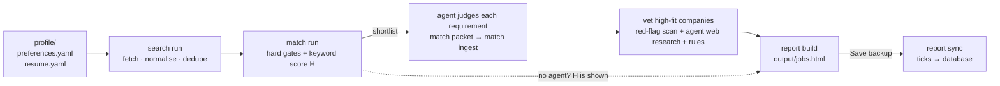

# JobHunt

**A personal, local job-search toolkit.** JobHunt finds jobs that fit *your* resume, scores them, checks that the
companies are real and safe, and lists everything in one offline HTML page. It is driven by the coding agent you
already use (Claude Code, OpenAI Codex CLI, Gemini CLI, Cursor, GitHub Copilot agent mode, Aider, …). The agent does
the reading and judging, so **you need no LLM API key and no paid job-platform API**. With no agent at all, the
search, the rule-based score and the report still work.

> JobHunt does **not** apply to jobs for you. It finds, ranks and checks them; you click "Open ↗" and apply yourself.

---

## What you get

- **One search across many sources.** Company job boards (Greenhouse, Lever, Ashby, SmartRecruiters, Workable,
  Recruitee, BambooHR, Breezy, Keka, Zoho Recruit), remote boards (Himalayas, Remotive, RemoteOK, We Work Remotely,
  Y Combinator), Indeed and Glassdoor, LinkedIn and Naukri (search only), and Google Jobs through SerpApi if you have
  a key. See [Sources](#sources).
- **Your country, your cities, your remote rules.** You set a home country, first- and second-choice cities, and
  the remote regions that include you (for example `IN, APAC, WORLDWIDE` or `US, WORLDWIDE`). Jobs you can't take
  are filtered out.
- **Duplicates merged.** The same role found on LinkedIn, Indeed and the employer's own board shows up once, and the
  employer's own link is kept.
- **Honest fit scores.** Code applies hard rules (too senior, wrong country, language you don't speak, pay below
  your floor). Then your coding agent checks each job requirement against facts from your resume. Code computes
  the final 0–100 score from those checks. A requirement with no evidence in your resume counts as unmet.
- **A Trust column.** Each job shows whether it came straight from the employer's job board (**Direct**), whether
  the company was checked for fake jobs, fees, service bonds and unpaid salaries (**Vetted / Caution / Rejected**),
  and any red-flag phrases found in the job text.
- **One page to work from.** `output/jobs.html` works offline in any browser. It has filters, sorting,
  **Applied ✓** ticks, notes, a "Not interested" tick, backup/restore and CSV export.
- **Your data stays with you.** Everything is stored in local files and one SQLite database. Nothing is uploaded.

## How it works



The rule is **"the agent judges, code computes."** The agent reads job text and searches the web. Code makes every
decision that can be written as a rule: filters, score arithmetic, evidence checks, vetting rules. Details are in
[docs/how-it-works.md](docs/how-it-works.md).

## Quick start

You need **Python 3.11 or newer** and `git`. Full instructions: [docs/getting-started.md](docs/getting-started.md).

**Windows (PowerShell)**

```powershell
git clone https://github.com/Amanraj9910/Job-for-you.git jobhunt
cd jobhunt
python -m venv .venv
.venv\Scripts\Activate.ps1
pip install -e .
jobhunt init
```

**macOS / Linux**

```bash
git clone https://github.com/Amanraj9910/Job-for-you.git jobhunt
cd jobhunt
python3 -m venv .venv
source .venv/bin/activate
pip install -e .
jobhunt init
```

`jobhunt init` copies the example profile (a fictional "Sam Example") into `profile/` and creates the database.
**Next, replace Sam with you.** See [Personalise it](#personalise-it). Then check everything:

```bash
jobhunt doctor
```

**With a coding agent:** open the folder in your agent and say *"find me jobs"* or *"run the daily job search"*.

**Without an agent** (or to see each step):

```bash
jobhunt companies import-seeds     # optional: add a starter list of company job boards
jobhunt search run                 # fetch jobs from all enabled sources
jobhunt match run                  # hard rules + keyword score, prints a shortlist
jobhunt report build --open        # open output/jobs.html
```

## Use it with your coding agent

| Agent | How it picks up the instructions |
|---|---|
| Claude Code | Reads `CLAUDE.md` and the skills in `.claude/skills/` |
| OpenAI Codex CLI | Reads [`AGENTS.md`](AGENTS.md) |
| Cursor | Reads [`AGENTS.md`](AGENTS.md) |
| GitHub Copilot (agent mode) | Reads [`AGENTS.md`](AGENTS.md) |
| Gemini CLI | Reads [`AGENTS.md`](AGENTS.md) if configured; otherwise tell it to |
| Aider and others | Tell it: *"Read AGENTS.md and follow it"* |

Most agents read `AGENTS.md` by themselves. If yours doesn't, start with *"read AGENTS.md"*. The step-by-step
playbooks the agent follows are in `playbooks/`: [setup](playbooks/setup.md), [search](playbooks/search.md),
[score](playbooks/score.md), [vet](playbooks/vet.md), [report](playbooks/report.md) and [daily](playbooks/daily.md).

Every command accepts `--json`, so any agent can read the output reliably.

## Personalise it

Two files describe you. `profile/preferences.yaml` says **what you want**: titles, keywords, country, cities,
remote regions, salary floor, search phrases. `profile/resume.yaml` holds **facts about you**: skills with honest
levels, and experience and project bullets. Pick one of three ways to fill them:

1. **Browser form.** Run `jobhunt profile form`, fill it in, click **Download profile**, then run
   `jobhunt profile import <path-to>/jobhunt-profile.json`.
2. **Ask your coding agent.** Say *"set up my JobHunt profile from my resume"*. It follows
   [playbooks/setup.md](playbooks/setup.md): it reads your resume (`jobhunt profile extract-text resume.pdf`),
   drafts both files, asks you about your preferences, and validates the result.
3. **Edit the YAML by hand.** Both example files have comments on every field.

Then run `jobhunt profile validate`. The full guide, with examples for several countries and roles, is
**[docs/personalize.md](docs/personalize.md)**.

## Is the job real? (verification)

Fake job posts are common, especially ones asking for "registration fees" or "refundable deposits". JobHunt checks
in layers. Details: [docs/vetting.md](docs/vetting.md).

1. **Direct from the employer.** Jobs read from a company's own applicant-tracking system (Greenhouse, Lever, …)
   are marked **Direct**. They are very hard to fake.
2. **Red-flag scan.** Code scans every job description for fees, deposits, service bonds, requests for original
   documents, WhatsApp/Telegram-only contact, free-email recruiters, unrealistic pay, unnamed clients and unpaid
   work.
3. **Web research by your agent.** For companies with a high-fit job, the agent runs a fixed set of searches
   (scam reports, salary-not-paid reports, bonds, review-site ratings, forums, layoffs, the official careers page)
   and writes down what it found, with a source link for each point.
4. **Fixed rules decide.** Code turns those findings into **ok / caution / reject** using the same rules every
   time. You make the final call on "caution" companies with `jobhunt vet decide`.

## Sources

| Source | What it is | Needs key? | Notes |
|---|---|---|---|
| `greenhouse`, `lever`, `ashby`, `smartrecruiters`, `workable`, `recruitee`, `bamboohr`, `breezy`, `keka`, `zohorecruit` | Public job boards of specific companies | No | Only polls boards on your company watchlist (`jobhunt companies …`) |
| `himalayas` | Remote-jobs search API | Optional | A key raises limits |
| `remotive` | Remote-jobs API | No | At most 4 calls a day, enforced locally |
| `remoteok` | Remote-jobs feed | No | At most 4 calls a day, enforced locally |
| `wwr` | We Work Remotely RSS feeds | No | Programming categories |
| `yc_jobs` | Y Combinator job board | No | India pages for India-based profiles; remote page for everyone |
| `jobspy_indeed`, `jobspy_glassdoor` | Indeed and Glassdoor in your home country | No | Uses the open-source `python-jobspy` library |
| `jobspy_linkedin` | LinkedIn search results | No | **Search only**, logged out, small budget |
| `jobspy_naukri` | Naukri search results | No | **Search only**, India-based profiles only |
| `serpapi` | Google Jobs through SerpApi | **Yes** (`SERPAPI_KEY`) | Paid service with a small free tier; off without a key |
| `workday` | Workday career sites | No | Opt-in, finds jobs only (Workday needs an account to apply) |
| `hn` | Hacker News "Who is hiring?" | No | Two steps; your agent extracts the postings |

Every source, its endpoint and its limits: [docs/sources.md](docs/sources.md).

## Privacy

- Everything runs on your computer. Your profile, the database and the report are local files.
- `profile/`, `data/jobhunt.db`, `data/cache/`, `output/`, `logs/` and `.env` are in `.gitignore`, so they are not
  committed even if you fork the project and push.
- JobHunt only contacts the job sites' public endpoints listed in [docs/sources.md](docs/sources.md) and, if you
  set one, SerpApi with your key. Your resume and preferences are never sent to any of them. Only your search
  phrases and locations go out, as normal search queries.
- Your coding agent reads your profile and job texts the same way it reads your code. What happens to that data
  depends on the agent you choose.

## Responsible use

JobHunt is built to be a polite, low-volume, single-user tool:

- Small call budgets per source, a pause between requests to the same site, and a descriptive User-Agent (add your
  contact in `.env` as `JOBHUNT_CONTACT`).
- **Never logs in** anywhere. No captcha solving, no proxies, no stealth browsers. `jobhunt doctor` fails if such
  packages are installed.
- LinkedIn and Naukri are **search, score and save only**. JobHunt never automates applying, messaging or
  connecting.
- If a site says "slow down" (HTTP 429, captcha, "blocked"), that source stops for the run.
- Don't republish or resell the job data you collect.

Read [docs/responsible-use.md](docs/responsible-use.md) before changing budgets.

## Documentation

| Page | For |
|---|---|
| [Getting started](docs/getting-started.md) | Install, first run, where files live |
| [Personalise](docs/personalize.md) | Every profile field, with examples |
| [How it works](docs/how-it-works.md) | Data flow, database, dedupe, location tiers |
| [Sources](docs/sources.md) | Every source, the company watchlist, HN |
| [Scoring](docs/scoring.md) | Gates, keyword score, agent judgment, bands |
| [Vetting](docs/vetting.md) | Is this job real? |
| [The report](docs/report.md) | Every column and filter of `jobs.html` |
| [Adding a source](docs/adding-a-source.md) | Contributors: new sources and countries |
| [Responsible use](docs/responsible-use.md) | Terms, rate limits, what we never do |
| [Troubleshooting](docs/troubleshooting.md) | FAQ |

## Project status and roadmap

This is the **search-only public version** (0.2). It finds, scores, vets and lists jobs. Applying stays with you.

Ideas where help is welcome:

- **More countries and cities** in `src/jobhunt/geo.py` (see [adding a country](docs/adding-a-source.md#adding-a-country)).
- **More sources**, especially regional job boards with public APIs or feeds.
- **Non-tech skill vocabulary.** The "skill gaps" list in `src/jobhunt/match/skills.py` is tech-focused today.
- **More tests**, especially fixture-based tests for sources and non-India geographies.

## Contributing

Contributions are welcome. Start with [CONTRIBUTING.md](CONTRIBUTING.md) and the
[source guide](docs/adding-a-source.md). Please follow the [Code of Conduct](CODE_OF_CONDUCT.md) and report security
issues as described in [SECURITY.md](SECURITY.md).

## License

[MIT](LICENSE).

## Disclaimer

JobHunt can't guarantee that any job, recruiter or company is legitimate. Vetting is advisory and based on public
information that may be incomplete or wrong. **Always verify an employer yourself before sharing personal
documents, and never pay to apply for a job.** This project is not affiliated with, endorsed by or sponsored by any
job site, applicant-tracking system or company it mentions. You are responsible for following each site's terms of
service.
