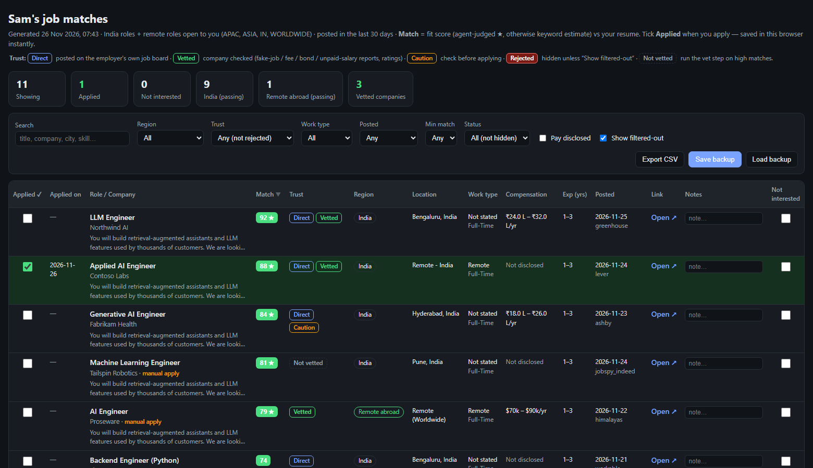
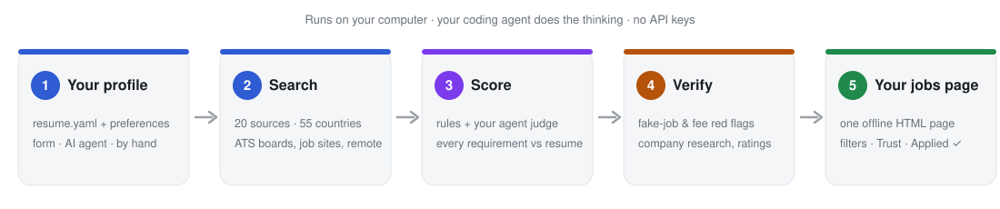
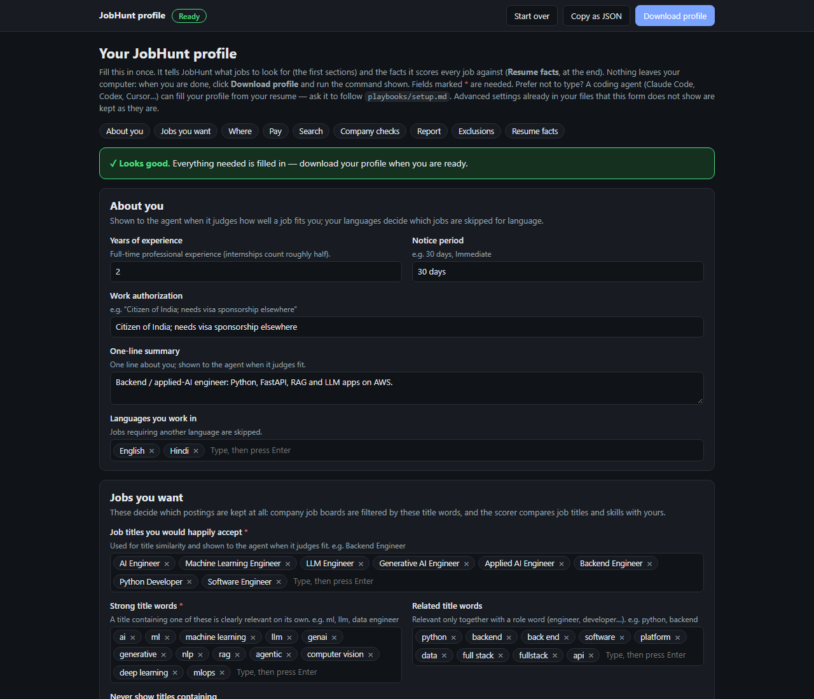

<div align="center">


# JobHunt

### Give this repo to your AI coding agent. It finds real jobs that fit your resume.

**No API keys · no paid job APIs · runs on your computer · works with Antigravity, Claude Code, Codex, Cursor, Gemini CLI, Copilot and more**

[](https://github.com/Amanraj9910/Job-for-you/actions/workflows/ci.yml)
[](https://github.com/Amanraj9910/Job-for-you/releases)
[](pyproject.toml)
[](LICENSE)
[](https://github.com/Amanraj9910/Job-for-you/stargazers)

[**Quick start**](#-quick-start-5-minutes) · [**Set up your profile**](#-set-up-your-profile-and-resume) · [**Features**](#-features) · [**How it works**](#-how-it-works) · [**Docs**](#-documentation)

<br>



<sub>Your jobs page: every match with its fit score, a Trust badge, location, pay and the link to apply. (Demo data, fictional companies.)</sub>

</div>

---

## 💡 What is JobHunt?

JobHunt is a job-search assistant you run on your own computer. You describe yourself once — your resume and what you
want — and it **searches 20 job sources, scores every job against your resume, checks that the companies are real,
and gives you one clean page** of the jobs worth applying to.

**You don't need any API key.** The "AI part" is the coding agent you already use. Open this repo in Antigravity,
Claude Code, Codex, Cursor, Gemini CLI or GitHub Copilot, say *"set up my profile from my resume and find me jobs"*,
and the agent follows the step-by-step playbooks in this repo. Without an agent, the search, the rule-based score
and the jobs page still work.

> JobHunt does **not** apply for you. It finds, ranks and checks jobs; you open the link and apply yourself.

## 📊 By the numbers

<div align="center">

| **20** | **55** | **0** | **11** | **379** | **100%** |
|:---:|:---:|:---:|:---:|:---:|:---:|
| job sources | countries supported | API keys needed | fake-job red-flag checks | automated tests | local & private |

</div>

## ✨ Features

| | Feature | What it means for you |
|:---:|---|---|
| 🔎 | **Searches 20 sources at once** | Company career pages (Greenhouse, Lever, Ashby, SmartRecruiters, Workable and more), Indeed, Glassdoor, LinkedIn and Naukri (search only), remote boards (Himalayas, Remotive, RemoteOK, We Work Remotely), Y Combinator and Hacker News. |
| 🎯 | **Matched to *your* resume** | Every job is checked requirement by requirement against facts from your resume, then scored 0–100. Nothing is invented: a skill you don't have counts as missing. |
| 🌍 | **Your country, your rules** | Set your home country, favourite cities, remote regions that include you, salary floor, languages and seniority. Jobs you can't take are filtered out. Works in 55 countries. |
| 🛡️ | **Fake-job protection** | Flags registration fees, deposits, service bonds, WhatsApp-only recruiters and other scam signs. Companies of top matches are researched for fraud reports, unpaid salaries and ratings. |
| ✅ | **Trust badges** | **Direct** = posted on the employer's own job board. **Vetted / Caution / Rejected** = result of the company check. Rejected companies are hidden. |
| 🧹 | **No duplicates** | The same job on LinkedIn, Indeed and the company site shows up once, with the employer's own link. |
| 📄 | **One page to work from** | An offline HTML page with filters, sorting, **Applied ✓** ticks, notes, "not interested", backup and CSV export. |
| 🤖 | **Works with any AI agent** | Plain-English playbooks (`AGENTS.md`, `playbooks/`) any coding agent can follow. No vendor lock-in. |
| 🔒 | **Private by default** | Your resume, profile and results never leave your computer and are never committed to git. |

## 🧭 How it works

<picture>
  <source media="(prefers-color-scheme: dark)" srcset="assets/how-it-works-dark.svg">
  
</picture>

1. **Your profile** — two small files: `resume.yaml` (facts about you) and `preferences.yaml` (what you want).
2. **Search** — fetches jobs from every enabled source, keeps those in your country or open to you remotely, removes
   duplicates.
3. **Score** — code applies hard rules (too senior, wrong country, pay below your floor…). Your agent then checks
   each requirement of the best jobs against your resume; code computes the final score.
4. **Verify** — job text is scanned for scam signs, and the companies of high matches are researched on the web.
5. **Your jobs page** — `output/jobs.html` lists everything with filters and Trust badges.

The rule is **"the agent judges, code computes"**: the agent reads and researches, while every decision that can be
written as a rule (filters, arithmetic, evidence checks, vetting rules) is done by code, the same way every time.
More: [docs/how-it-works.md](docs/how-it-works.md).

## 🚀 Quick start (5 minutes)

You need **Python 3.11+** and **git**.

**1. Download and install**

```bash
git clone https://github.com/Amanraj9910/Job-for-you.git jobhunt
cd jobhunt
python -m venv .venv
# Windows:      .venv\Scripts\Activate.ps1
# macOS/Linux:  source .venv/bin/activate
pip install -e .
jobhunt init
```

**2. Open the `jobhunt` folder in your AI agent** and say:

> *"Read AGENTS.md. Set up my JobHunt profile from my resume at `C:\Users\me\Documents\resume.pdf`, then find me jobs."*

**3. Open your jobs page** — the agent ends by building it, or run `jobhunt report build --open` yourself.

That's it. Next time just say *"run the daily job search"*.

<details>
<summary><b>Which agents work, and how they find the instructions</b></summary>

| Agent | How it picks up JobHunt's instructions |
|---|---|
| **Google Antigravity** | Open the folder and say *"Read AGENTS.md and follow it"* |
| **Claude Code** | Automatically: reads `CLAUDE.md` and the skills in `.claude/skills/` |
| **OpenAI Codex** (CLI / IDE) | Automatically: reads [`AGENTS.md`](AGENTS.md) |
| **Cursor** | Automatically: reads [`AGENTS.md`](AGENTS.md) |
| **GitHub Copilot** (agent mode) | Automatically: reads [`AGENTS.md`](AGENTS.md) |
| **Gemini CLI** | Reads `AGENTS.md` if configured; otherwise say *"read AGENTS.md"* |
| **Windsurf, Aider, others** | Say *"Read AGENTS.md and follow it"* |

The agent follows the playbooks in [`playbooks/`](playbooks): [setup](playbooks/setup.md),
[search](playbooks/search.md), [score](playbooks/score.md), [vet](playbooks/vet.md), [report](playbooks/report.md)
and [daily](playbooks/daily.md). Every command supports `--json`, so agents read results reliably.

</details>

<details>
<summary><b>Run it without an agent</b></summary>

```bash
jobhunt companies import-seeds     # optional: a starter list of company job boards
jobhunt search run                 # fetch jobs from all enabled sources
jobhunt match run                  # hard rules + keyword score, prints a shortlist
jobhunt report build --open        # open output/jobs.html
```

Without an agent you get the keyword score instead of the requirement-by-requirement judgment, and no web research
on companies (the job-text red-flag scan still runs).

</details>

## 👤 Set up your profile and resume

JobHunt only knows what your two profile files tell it, so this step decides how good your matches are.

| File | Holds | Example |
|---|---|---|
| `profile/resume.yaml` | **Facts about you** — skills (with honest levels), jobs, projects, education, certifications | [profile.example/resume.yaml](profile.example/resume.yaml) |
| `profile/preferences.yaml` | **What you want** — job titles, keywords, country & cities, remote regions, salary floor, search phrases | [profile.example/preferences.yaml](profile.example/preferences.yaml) |

`jobhunt init` creates both files from a fictional example ("Sam Example"). Replace Sam with you using **one** of
these three ways:

### Option A — Let your AI agent do it (easiest)

1. Put your resume (PDF, DOCX, Markdown or text) somewhere on your computer.
2. Tell your agent: *"Set up my JobHunt profile from my resume at `<path>`."*
3. The agent reads your resume (`jobhunt profile extract-text <path>`) and drafts `resume.yaml` **only from what your
   resume says**.
4. It asks you a few questions in one message — titles you want, years of experience, home country and cities,
   remote preference, salary floor, languages — and writes `preferences.yaml`.
5. It validates both files and shows you a summary to confirm.

### Option B — Fill in a form in your browser

```bash
jobhunt profile form          # opens an offline form, prefilled with the example
```



Fill it in, click **Download profile**, then:

```bash
jobhunt profile import ~/Downloads/jobhunt-profile.json
```

### Option C — Edit the YAML files by hand

Open `profile/preferences.yaml` and `profile/resume.yaml` in any editor. Every field has a comment explaining it.

### Then check it

```bash
jobhunt profile validate      # finds typos and missing fields
jobhunt profile show          # shows exactly what the search will use
```

Tips: write **short, specific search phrases** ("LLM engineer", "data analyst"), list **only skills you've really
used**, and set `home_country` to your two-letter code (`IN`, `US`, `GB`, `DE`…). The full guide — every field, with
examples for India, the US, Germany and the Philippines — is **[docs/personalize.md](docs/personalize.md)**.

## 🛡️ Is the job real?

Fake job posts are common, especially ones asking for "registration fees" or "refundable deposits". JobHunt checks
in layers ([details](docs/vetting.md)):

1. **Direct from the employer** — jobs read from a company's own hiring system (Greenhouse, Lever, …) are marked
   **Direct**. They are very hard to fake.
2. **Red-flag scan** — code scans every job description for fees, deposits, service bonds, requests for original
   documents, WhatsApp/Telegram-only contact, free-email recruiters, unrealistic pay, unnamed clients and unpaid work.
3. **Web research by your agent** — for companies with a high-fit job, the agent searches for scam reports,
   unpaid-salary reports, bonds, review-site ratings, forum threads, layoffs and the official careers page, and cites
   a source link for every finding.
4. **Fixed rules decide** — code turns the findings into **ok / caution / reject**, the same way every time. You make
   the final call on "caution" companies.

## 🔌 Sources

| Source | What it is | Key needed? |
|---|---|---|
| Greenhouse, Lever, Ashby, SmartRecruiters, Workable, Recruitee, BambooHR, Breezy, Keka, Zoho Recruit | Companies' own job boards (from your watchlist) | No |
| Indeed, Glassdoor | Job sites, in your home country | No |
| LinkedIn, Naukri | **Search only**, logged out, small volume (Naukri: India only) | No |
| Himalayas, Remotive, RemoteOK, We Work Remotely | Remote-job boards | No |
| Y Combinator jobs, Hacker News "Who is hiring?" | Startup jobs | No |
| Workday | Large employers (find only — applying needs an account) | No |
| Google Jobs via SerpApi | Optional extra source | Yes (`SERPAPI_KEY`) |

Endpoints, limits and how to build your company watchlist: [docs/sources.md](docs/sources.md).

## 🔒 Privacy

- Everything runs on your computer: your profile, the database and the jobs page are local files.
- `profile/`, `data/`, `output/` and `.env` are git-ignored — they are never committed, even in a fork.
- JobHunt only sends normal search queries (your search phrases and locations) to the job sites. Your resume and
  preferences are never sent to them.
- Your coding agent reads your profile the way it reads your code; what happens to that data depends on the agent.

## 🤝 Responsible use

JobHunt is a polite, low-volume, single-user tool: small call budgets, a pause between requests, a descriptive
User-Agent, **no logins, no captcha solving, no stealth browsers**. LinkedIn and Naukri are **search only** — it never
applies, messages or connects. If a site says "slow down", that source stops. Please don't republish the job data
you collect. See [docs/responsible-use.md](docs/responsible-use.md).

## 📚 Documentation

| Page | What's inside |
|---|---|
| [Getting started](docs/getting-started.md) | Install on Windows/macOS/Linux, first run, where files live |
| [Personalise](docs/personalize.md) | Every profile field, with examples for several countries |
| [How it works](docs/how-it-works.md) | Data flow, database, de-duplication, location tiers |
| [Sources](docs/sources.md) | Every source and the company watchlist |
| [Scoring](docs/scoring.md) | Hard rules, keyword score, agent judgment, bands |
| [Vetting](docs/vetting.md) | How fake jobs and bad employers are caught |
| [The jobs page](docs/report.md) | Every column, filter and button |
| [Troubleshooting](docs/troubleshooting.md) | FAQ |
| [Adding a source](docs/adding-a-source.md) | For contributors: new sources and countries |

## 🗺️ Roadmap

This is the **search-only public version (0.2)**: it finds, scores, verifies and lists jobs; applying stays with you.
Help is welcome with:

- 🌍 **More countries and cities** in `src/jobhunt/geo.py` ([how](docs/adding-a-source.md#adding-a-country))
- 🔌 **More sources**, especially regional job boards with public APIs or feeds
- 🧠 **Non-tech skill vocabulary** for designers, analysts, marketers and more
- 🧪 **More tests**, especially for non-India locations

Known limitations are listed in the [changelog](CHANGELOG.md).

## 🙌 Contributing

Contributions are welcome! Start with [CONTRIBUTING.md](CONTRIBUTING.md) and the
[source guide](docs/adding-a-source.md). Please follow the [Code of Conduct](CODE_OF_CONDUCT.md), and report security
issues privately as described in [SECURITY.md](SECURITY.md). If JobHunt helps you, a ⭐ helps others find it.

## ⭐ Star history

<a href="https://star-history.com/#Amanraj9910/Job-for-you&Date">
  <picture>
    <source media="(prefers-color-scheme: dark)" srcset="https://api.star-history.com/svg?repos=Amanraj9910/Job-for-you&type=Date&theme=dark">
    
  </picture>
</a>

## 📄 License and disclaimer

[MIT](LICENSE). JobHunt can't guarantee that any job, recruiter or company is legitimate; vetting is advisory and
based on public information that may be incomplete or wrong. **Always verify an employer yourself before sharing
personal documents, and never pay to apply for a job.** JobHunt is not affiliated with any job site,
applicant-tracking system or company it mentions; you are responsible for following each site's terms of service.
